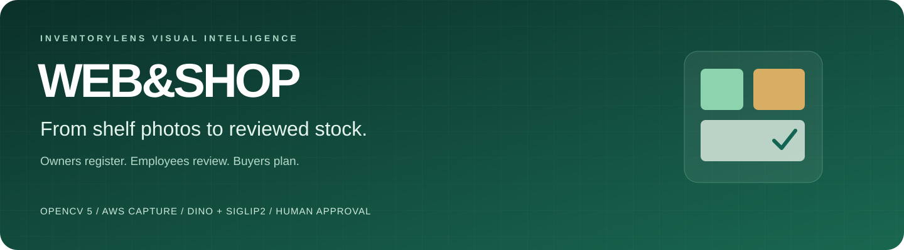
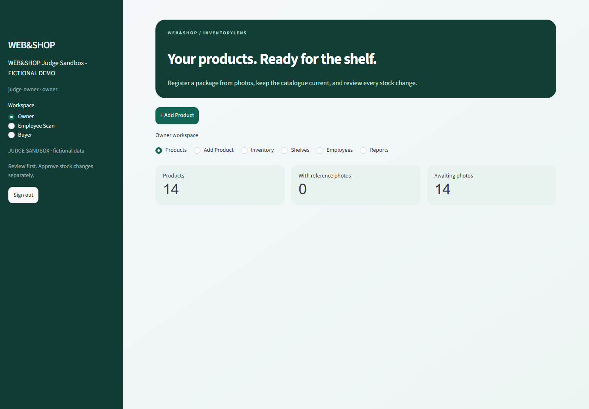
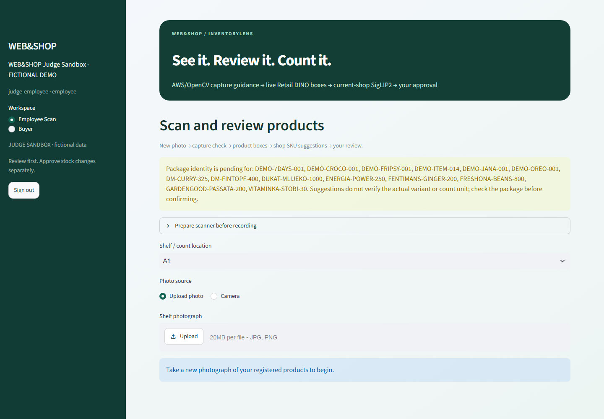
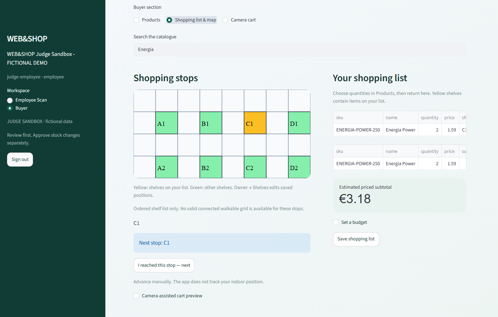
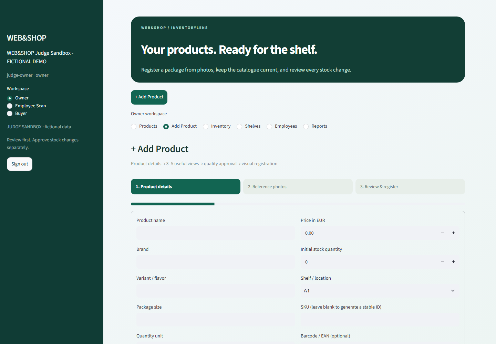
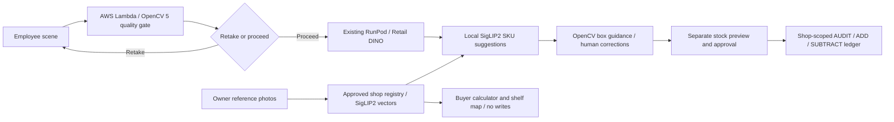



# WEB&SHOP — Intelligent Shopping & Inventory Management

**Powered by InventoryLens Visual Intelligence | OpenCV 5 + AWS**

Register a product from reference photos, review what the camera counted, and approve the stock change. Buyers use the same shop catalogue to plan quantities, estimate a budget and find assigned shelves.

[Demo guide](docs/demo.md) · [Architecture](docs/architecture.md) · [Features](docs/features.md) · [Evaluation](docs/evaluation.md) · [Deployment](docs/deployment.md) · [Security & licensing](docs/security.md)

> **Release status — October 25, 2026:** the integrated Streamlit application works locally. AWS OpenCV capture and RunPod DINO have genuine measured execution evidence. An isolated sandbox's temporary HTTPS gateway reaches email sign-in for the allowlisted operator; **judge access and authenticated external workflows remain unverified**. Video upload and final submission are not claimed complete.

## Three roles. One catalogue.

| Owner | Employee | Buyer |
|---|---|---|
| Register 3–5 approved reference views, set price/stock/shelf, import a validated workbook and manage staff | Check photo quality, run actual DINO/SigLIP2, correct grouped quantities and individual boxes, then explicitly approve stock | Choose quantities, estimate euro totals/budget, inspect highlighted shelves and advance through stops manually |

### Owner workspace



The cards above are the **actual photo-free judge sandbox**. Placeholder panels explicitly require reference photos; no fabricated embeddings are attached to provisional catalogue IDs. The private development shop's photos are not reproduced here.

### Employee scan



Numbered, color-coded boxes and grouped review appear after an image is analyzed. Users can add a missed product, change quantity, correct a SKU, remove a false proposal, or split a merged box. Stable detection IDs and correction provenance are retained. Unknown products request registration rather than silently becoming units of a known SKU.

### Buyer calculator and shelf map



Products, shopping list, budget and cart preview use the current shop's prices. Yellow shelves contain list items. Missing prices/locations remain explicit. Buyer actions never write stock. There is no simulated indoor positioning, and a shortest-route claim is never made without a valid owner-authored walkable grid.

## Register a new SKU without per-SKU retraining

1. **Owner → + Add Product:** name, brand, variant, size, unit, price, initial quantity, shelf and optional barcode.
2. Upload **3–5 useful views**; inspect blur/exposure/framing guidance, label views and approve each image. Fewer views can be saved as an incomplete draft.
3. Review the summary and explicitly register. Originals, normalized references, genuine SigLIP2 vectors, model revision and image hashes are persisted atomically.
4. The shop gallery updates immediately. Test with a **different scene photo**, not a reference image.



The existing detector checkpoint was previously fine-tuned for retail detection; adding a catalogue SKU does not train it or SigLIP2. Similar-looking variants, partial products and missed detections still require human review.

## How visual evidence becomes an action



OpenCV 5 performs substantive analysis: decode/dimensions, focus, exposure, retake/proceed decisions, and post-detection frame/overlap guidance. AWS is the existing private S3-triggered Lambda in **eu-north-1**. Neural detection runs on **RunPod**, not AWS; reference recognition runs locally in the application process. [Architecture and runtime boundaries](docs/architecture.md).

LIVE, LOCAL capture, AWS capture and private archived REPLAY are distinct modes. AWS failure requires an explicit LOCAL selection. Failed GPU inference does not silently become replay. Private archived photos are disabled in the judge sandbox.

## Measured, with limits

| Observation | Verified result |
|---|---|
| Actual new-product acceptance | Five real references registered; distinct scene assigned the new SKU to the front can; employee explicitly approved one isolated demo unit |
| Genuine AWS quality feedback | Reference PROCEED; intentionally blurred control RETAKE; distinct scene PROCEED, with matching image hashes and OpenCV 5.0.0 |
| Matching ten actual crops | Serial **14.37 s** → batch-four **7.57 s**, with the same SKU decisions |
| Prepared LIVE recognition | **27.59 s**, including **20.02 s** DINO request; upload, AWS check, cold preparation and rendering are additional |
| Human-control boundary | Stock unchanged before explicit action approval; buyer estimate did not modify inventory |

These are bounded development observations, **not end-to-end accuracy or a broad reliability estimate**. The scene contained partial proposals and unknowns. Ten model proposals are not ten verified units. Repeating the same product/scene does not create independent evaluation evidence. [Conditions, earlier reports and failure cases](docs/evaluation.md).

## Run the isolated judge sandbox

Verified local environment: Python 3.14 with the pinned packages below. The setup does not create cloud resources or download model weights.

```powershell
py -3.14 -m venv .venv
.venv\Scripts\python.exe -m pip install -r requirements-judge.txt
.venv\Scripts\python.exe tools\prepare_judge_demo.py
.\tools\start_webshop_judge.ps1
```

Open **http://localhost:8511**. The setup creates a fictional shop and separate generated credentials in ignored `data/judge_release/access.json`. It copies no private photos or embeddings. Existing sandboxes are preserved. Supply the generated access code and role credentials privately; do not put them in the video or public repository.

Product browsing/calculation/map work with the fictional fixture. Real registration requires the operator's existing pinned SigLIP2 cache. LIVE detection requires the existing private RunPod connection. AWS capture requires the operator's existing authorized resources/profile. Those dependencies are explicit, not bundled credentials or a pretend self-contained cloud service. [Full setup, HTTPS alternatives, cost and fallback behavior](docs/deployment.md).

For the existing full local shop, the operator uses `./tools/start_webshop_ux_demo.ps1` on **8509**. Its separate historical release remains on **8508**. These private working databases are not included in the repository.

## Technology

| Component | Role |
|---|---|
| Python / Streamlit | Guided registration, interactive review, three role views, responsive native UI |
| OpenCV 5 | Capture-quality decisions and box geometry |
| AWS S3 + Lambda | Existing private cloud capture analysis in eu-north-1 |
| NVIDIA Retail DINO / existing RunPod worker | Class-agnostic retail product detection |
| Pinned SigLIP2 image tower | Shop-reference-based SKU retrieval |
| SQLite and existing inventory service | Authoritative shop catalogue, permissions, idempotent stock ledger |
| Lightweight SVG / native controls | Owner shelf layout, buyer highlights and manual progression |

## Verify without a GPU benchmark

```powershell
.venv\Scripts\python.exe -m unittest tests.test_judge_release tests.test_registration_8509 tests.test_practical_ux
.venv\Scripts\python.exe tools\check_publication.py --tracked
```

Local tests cover isolation, atomic registration, drafts, duplicates, quality gates, cached-vector freshness, grouped corrections, prices, map state, confirmation, idempotency and buyer no-write behavior. Cloud/model failures are explicitly mocked; actual inference evidence is separate. Pinned dependencies are in `requirements-live-scan.txt` and `requirements-judge.txt`; optional legacy dependencies are separate.

## Repository guide

| Path | Purpose |
|---|---|
| `app_8509.py`, `app_judge.py` | Integrated release and isolated judge entrypoint |
| `registration_8509.py`, `registration_wizard_8509.py` | Atomic reference registration and guided UI |
| `scanner_8509.py`, `review_8509.py`, `live_scan.py` | Inference adapter, interactive review and evidence |
| `gallery_8509.py`, `siglip_8509.py` | Content-bound vector cache and safe pinned image-tower loading |
| `inventory.py`, `db.py`, `auth.py` | Existing shop authorization, catalogue and ledger |
| `buyer_8509.py`, `shop_catalog.py`, `shop_map.py` | Shared prices, importer, buyer tools and layout |
| `experiments/opencv5_guided_scan/` | Existing OpenCV/AWS capture component; historical experiments remain separate |
| `demo_data/` | Fictional import workbook; not verified live inventory |
| `docs/`, `tests/`, `tools/` | Current judge documentation, targeted checks and reproducible setup |

The existing `graphipy-out-animation/` is a historical interactive project/research graph. It is not the buyer map, a deployed endpoint or a benchmark result.

## Privacy, licensing and submission

Private databases, credentials, reference photos, masks, vectors, model weights, videos and connection files stay out of Git. Existing private photos require explicit approval before appearing in public screenshots/video. Whole-host authentication must protect Streamlit media and WebSocket routes; a UI password alone is insufficient. [Security and third-party terms](docs/security.md).

Original project code retains its [MIT license](LICENSE). NVIDIA models/TAO, SigLIP2, optional Ultralytics code and uploaded photographs retain their own terms. Check those terms before redistribution; no checkpoints are shipped here.

This entry targets the **OpenCV AI Competition 2026, powered by AWS**. No COOL or Agentic Vision special-award claim is made. The [demo checklist](docs/demo.md) distinguishes completed local work from pending HTTPS verification, final team/video footage, upload and submission. [Official requirements](https://opencv26.devpost.com/).
