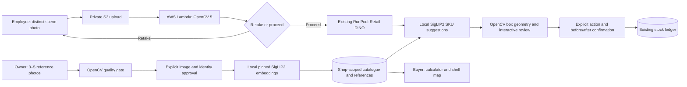
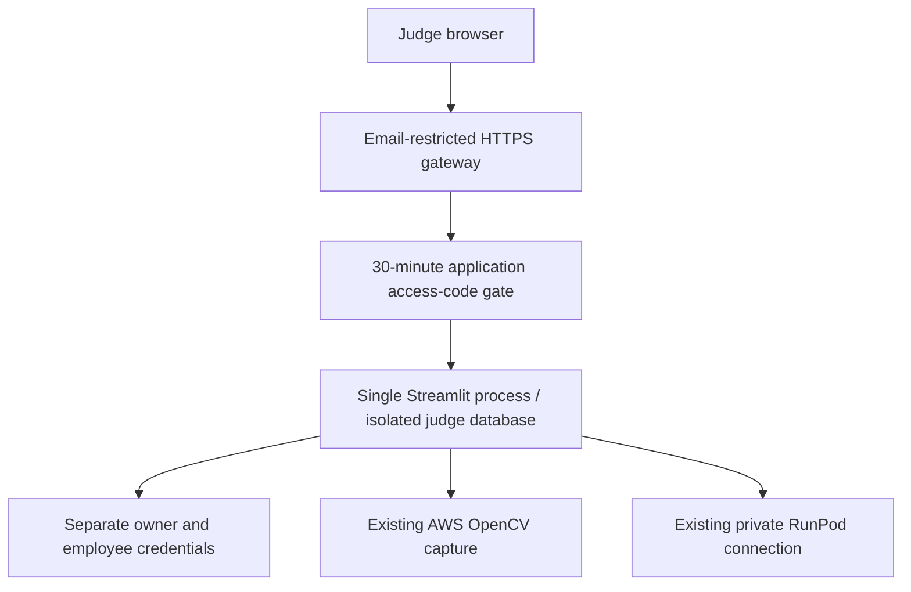

# Architecture

WEB&SHOP is the application; InventoryLens supplies visual registration, recognition and inventory review. The integrated release is Python/Streamlit. The existing OpenCV 5 capture component executes on AWS in eu-north-1. DINO executes on an existing RunPod worker; SigLIP2 executes in the application process. Neither neural model is hosted by the AWS capture Lambda.

The temporary HTTPS gateway reaches email sign-in for the operator; judge allowlisting and authenticated external acceptance remain pending. It must cover HTTP media routes and WebSocket connections as well as the landing page. The local app gate alone does not protect Streamlit media URLs. One server process avoids cross-replica SQLite and session-affinity problems. No public serving of the project directory is enabled. [Deployment details](deployment.md).

OpenCV measures resolution, focus and exposure before inference; local post-DINO geometry checks frame contact and intersection-over-union. Box overlap is not the percentage of a physical product visible. A blurred image requests a retake. Exposure-only overrides require a reason; AWS failure requires an explicit LOCAL choice. Neural suggestions do not approve stock.
