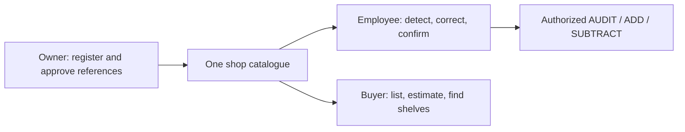
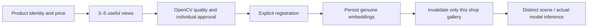

# Workflows and limitations

| Role | Working local release |
|---|---|
| Owner | Import workbook preview/validation; shared catalogue; register 3–5 approved photos with stable SKU, price, opening stock and shelf; incomplete drafts; reference embeddings; edit price/shelf; export; employee membership; recognition test |
| Employee | AWS/LOCAL capture guidance; fresh DINO boxes; shop-only SigLIP2 alternatives; grouped quantities; stable per-box corrections; add missed units; remove/split detections; unknown-product registration requests; separate stock confirmation |
| Buyer | Current-shop prices; editable shopping quantities; budget; camera cart estimate; highlighted assigned shelves; manual stop progression; no stock writes |

Default stock behavior is review-only. ADD receives units; SUBTRACT removes units; AUDIT sets counts only for an explicit scope. Before/after previews and submission keys protect against unintended or duplicate writes. Product registration and opening stock are atomic with file/embedding failure handling.

Registration does not retrain models. Masks are optional; originals and selected existing cached-mask representations remain distinct. Provisional workbook IDs do not get fabricated references or embeddings. Similar packages, missed detections, partial boxes and unknown assignments require human review. A route is drawn only for a valid connected owner-authored grid; otherwise only an ordered shelf list is shown.

The public-safe screenshots show the actual isolated sandbox, with **no private photos copied**. Placeholder panels mean reference photos are required, not that embeddings exist. Private development replay is disabled in the judge sandbox. Its operator must register approved demonstration photos before claiming a LIVE recognition result there.
