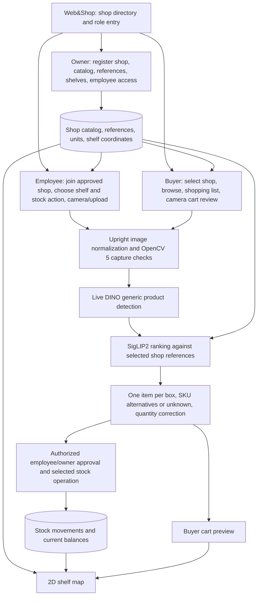

# Web&Shop delivery decision — 24 October 2026

This is a source/artifact audit and implementation plan. It does not claim a fresh inference run, deploy resources, change inventory, or start training. It supersedes the ordering in older planning documents where those documents still say no TAO training or item review has happened.

## What the evidence supports

| Component | Evidence and interpretation |
|---|---|
| Actual DINO training | `<LOCAL_FILES>/train/status.json` records 12 validation evaluations and successful completion on 21 October. `experiment.yaml` specifies FAN base, generic product detection, frozen backbone and transformer encoder, and 12 epochs. The prepared reviewed dataset has 25 training photos / 144 boxes and five validation photos / 33 boxes. |
| Validation | Final recorded mAP is 0.9254 and mAP50 is 0.9449. The five-photo validation set is too small to establish performance on crowded, new employee photographs. These figures are not employee-demo accuracy or SKU accuracy. |
| Returned inference | The evaluation bundle manifest names epoch 11, SHA-256 `8bb11d6d63f26edfd480bdf1264467bd5c080f190fbb83a034b252d13ee20d27`. Returned inference status records loading that filename and successful completion on 21 October. The returned status alone does not cryptographically verify which checkpoint bytes ran remotely. |
| Human detector review | 30 scenes / 291 annotated items; 278 detector proposals; 207 TP, 71 FP, 84 FN at IoU 0.50. Precision 74.5%, recall 71.1%, F1 72.8%. Employee F1 74.3%. Crowded annotations remain uncertain. |
| Evaluation metadata defect | `dino/evaluate_dino_review.py` reads boxes from returned DINO KITTI labels, but copies model timestamp and settings from the earlier YOLO `predictions.json`. The report needs explicit DINO inference provenance and settings rather than that misleading metadata. The counts are computed from DINO labels; the old date is not evidence of failed training. |
| SKU review | The complete export covers 291 human-drawn items: 290 confirmed candidate labels and one uncertain label. Combined-gallery top-1 agreement is 271/290 (93.4%); top-three is 283/290 (97.6%). The reviewer saw suggestions. This tests human-box crop retrieval, not automatic detector-to-SKU performance. |
| Identity | Three products have decoded package GTIN evidence; none of the ten candidate identities is formally marked confirmed in the ranking registry. A shop may assign its own SKU without a GTIN. It still needs owner-approved identity, variant, counting unit, and reference photos. |
| Existing application | Streamlit, SQLite, business-scoped owner/employee authorization, references, inventory locations, camera/upload, CSV quantity import, scan approval and history exist. Its current recognition uses MobileSAM/reference matching or YOLOE, not the reviewed DINO/SigLIP2 pipeline. Approval saves count snapshots. |
| Missing product integration | Main platform onboarding, buyer flow, spreadsheet catalog import with shelf mapping, live DINO/SigLIP2 scanning, and signed stock movements are not complete. The guided AWS demo replays recognition for matching archived images. |

Sources: `experiments/first_two_train_third_test_20261020/README.md`, `dino/train.yaml`, `.build_dino_eval/inventorylens-dino-eval/manifest.json`, `artifacts/third_set_review_20261020/dino_inference/results/status.json`, `dino_ground_truth_eval_20261023.json`; `experiments/new_product_scanning_20261020/results/reviewed_item_sku_ranking_20261023T075154Z/sku_decision_evaluation_20261024_v2/report.json`; `results/sku_identity_verification_20261024.csv`; `app.py`, `auth.py`, `db.py`, `inventory.py`, `owner_ui.py`.

## Training decision

Do not start an arbitrary five-new-product training run before establishing fresh-photo inference. No defensible percentage improvement can be predicted from the current evidence. The most plausible training benefit is learning separate boxes for touching, stacked, partially hidden, and small products. Additional product names do not themselves supply that supervision. Full occlusion cannot be solved by a detector.

User update: the third-set physical products are unavailable. Use the second grocery set for the application and new-photo demonstration, including Energia, Dukat and Fripsy. Start with those accessible products; add two more physically available second-set products to reach five if practical. Do not make third-set products a dependency. Owner approval of each exact local SKU and sale/count unit is required. `experiments/runpod_gpu_inference/catalog_crosswalk.csv` verifies Energia's existing registration and Dukat 1 L 2.8% milk; Fripsy chicken-flavour sticks to `MAKS-CRISPY-50` remains a candidate mapping and must be checked against the actual packet. Avoid silently substituting Croco Pizza references for Croco salt crackers; the crosswalk explicitly rejects that variant mismatch. Keep third-set reviews as separate historical evaluation evidence.

Create a shop-specific SigLIP2 gallery from the second-set references, checking actual variant and package size. Never carry third-set ranking percentages into second-set performance claims. Some second-set photos/products contributed to prior training. Fresh second-set photos therefore test new arrangements of known products; they do not prove generalization to unseen product identities. Fresh photo bytes and arrangement groups must be excluded from training, validation and threshold selection for the final confirmation set.

One targeted retraining comparison is a secondary task, capped at four hours of engineering time, after a new image can travel through the real inference path. Reuse reviewed development annotations plus corrected hard cases, retaining useful older examples. Group related arrangements into the same split. Existing 30 reviewed scenes may become development data, but must then lose their held-out designation. Select checkpoint and thresholds on validation data. Promote a new checkpoint only if the same validation scenes show better localization and counts without sacrificing SKU counts on easier scenes. Keep the current checkpoint as a fallback. Do not keep changing models against the final test set.

## Application decision

Build one Web&Shop application with three role views and one shared shop catalog. Reuse the existing application/service code and persistence instead of starting a second framework or disconnected visual mockup. Develop against an isolated demo database. Ordinary feature development and local testing start immediately.

The diagram is a target implementation, not a deployment claim. Keep the existing AWS OpenCV capture service in eu-north-1. A fresh-photo detector worker may run outside AWS while this component stays on AWS; label runtime locations accurately. Decide the worker deployment only after one-image runtime/latency verification and checking the existing GPU budget. Do not create new AWS resources under this plan.

Owner features: shop creation; spreadsheet import preview and validation; approved product references; shelf placement; owner-approved employee membership; inventory/history. Selecting a public shop must not grant employee write access.

Employee features: camera and upload; selected shop references only; capture guidance; numbered item boxes; top-three suggestions and unknown state; add/split/remove/correct controls; explicit approval. A shelf audit sets a reviewed snapshot. Receiving adds units and authorized removal subtracts them. Keep those actions distinct, with duplicate-approval protection and an audit receipt. Implement and test the needed stock actions against demo balances before claiming them.

Buyer features: shop selection, catalog search, shopping list, shelf highlights, and camera-based cart preview using the same catalog and recognition service. Shelf coordinates must be owner supplied. A 2D map highlights known shelf positions; it does not infer the floor plan or the buyer's live position. Adding an item to a cart does not reduce stock. Payment remains deferred.

## Demo data and spreadsheets

Create fixture data at the start of application work: fictional shop name, prices, initial quantities, employee identity, shelf labels and map coordinates. Use actual approved product identities/reference photos for the five demo SKUs. Mark illustrative prices and opening balances as demo data.

The owner workbook should contain a Products sheet (`sku`, `name`, `gtin` optional, `unit`, `price`, `shelf_id`, `initial_quantity`) and Shelves sheet (`shelf_id`, `label`, `x`, `y`, `width`, `height`). Coordinates use one documented map coordinate system. Use validated preview/import with rollback on invalid rows. References are uploaded/mapped by SKU separately. One workbook is the source for employee and buyer views; avoid separate copies that drift.

Fixture proposals may unblock UI work while the inference adapter is being built, but must be visibly demo proposals. Replace them with computed predictions before the unseen-photo demonstration. Never invent predictions or silently substitute saved predictions for new uploads. Retain archived replay only as an explicitly labeled reproducible example.

## Finish the testing

1. Audit orientation and output coordinates from source through detector, crop, overlay and annotation. Some originals have EXIF 6 and different raw/upright dimensions. Use one normalized upright pixel image for inference, display and annotation; preserve originals. Verify at least one portrait, landscape and EXIF-rotated case. Record checkpoint hash, inference settings and runtime in a proper DINO manifest.
2. Run one genuinely new second-set employee photograph through DINO and SigLIP2 against the second-set shop gallery, all the way to the application. Record latency and inspect boxes/crops. Failure to execute fresh inference is a release blocker for the intended demo, regardless of fine-tuning results.
3. Compute the missing end-to-end baseline on automatic detector crops for the reviewed scenes. Match predicted boxes one-to-one to reviewed items and compare predicted SKU labels. Report localization, SKU recognition, per-SKU count error and exact-count photos separately; do not multiply the two existing scores.
4. Collect 20 fresh second-set photographs in independent arrangements: ten ordinary shelf scenes, five crowded/stacked scenes, and five cases with unregistered products/distractors. Include varied angle, lighting and repeated Energia/Dukat/Fripsy units. Record expected visible items and SKUs before exposing model suggestions. Reserve this set as final confirmation, not threshold tuning or training. This is a small demo test on known shop products, not a broad generalization benchmark.
5. After validation/model decisions, freeze detector, reference gallery and thresholds, then run the final set once. Report misses, false boxes, wrong/unknown SKUs, count error, latency and manual corrections, including failure examples. Additional test-driven changes require new confirmation photos or explicit disclosure that the test became development data.
6. Exercise owner-to-employee-to-buyer data consistency, import failures, cross-shop access denial, repeated approval, stock action semantics and map placement. The existing tests must continue to pass for affected code. Capture a complete manual demo rehearsal before recording.

## Order and time budget

The 24 October audit was performed around 17:38 Europe/Zagreb. The Devpost header displays 26 October 23:45 PDT, which is 27 October 08:45 Zagreb: approximately 63 hours remain. Treat this as elapsed calendar time, including sleep. Aim to submit on Monday evening, leaving Tuesday morning as contingency.

| Order | Focused work allocation | Required outcome |
|---|---|---|
| 1 | First 3–4 hours | Fix provenance/coordinate checks, prove one fresh-photo inference, approve the five local product identities, seed the demo workbook/database. |
| 2 | Next 8–12 hours | Connect real scan proposals to existing application review and demo inventory; owner catalog import and employee flow work together. |
| 3 | Next 4–6 hours | Main shop entry, buyer catalog/list/cart preview and shelf map share the same data. |
| 4 | Optional, at most 4 hours | One targeted DINO comparison only after fresh inference works and the grouped training/validation data are ready. Skip if it threatens delivery. |
| 5 | Next 4–6 hours | End-to-end/final-photo tests, corrections, cross-role rehearsal, freeze features. |
| 6 | Final 5–6 focused hours plus buffer | Update outdated submission claims and diagram; pin/reproduce the runtime; record the under-five-minute video; prepare judge access and submit. |

Keep the employee fresh-photo scan as the central feature. If time contracts, simplify buyer styling and map controls first; preserve genuine recognition, explicit review, and correct inventory semantics. No payment work before the submission package is complete.

Official requirements and displayed deadline: https://opencv26.devpost.com/. NVIDIA DINO training/evaluation concepts: https://docs.nvidia.com/tao/tao-toolkit/latest/text/cv_finetuning/pytorch/object_detection/dino.html. Use the existing TAO 5.5 configuration for reproducibility; current documentation is not a reason to upgrade the runtime during delivery.

## AWS and OpenCV assessment

The competition requires substantive OpenCV 5 image/video analysis and a meaningful AWS component. The documented OpenCV 5 S3/Lambda capture analysis is a plausible basis for meeting those technical requirements: AWS runs pixel analysis and returns an actionable capture result. Final eligibility is the organizers' decision; this does not establish completion of all submission requirements or a competitive score. OpenCV technical execution is weighted 30%, and cloud delivery/reproducibility/responsible operation 10% on the official page.

The present focus/exposure/resolution gate is useful but limited in technical depth. Its 176/176 local/cloud agreement establishes execution consistency, not 100% photo-quality or SKU accuracy. Strengthen it by connecting the existing AWS gate to actual new-photo scanning in the main application: retake leads to a better capture, proceed leads to live proposals and review, and AWS failure has a visible retry/explicit local fallback state. Measure latency, retake outcomes, count/SKU errors and correction effort on a small labeled capture set, including real poor/good capture pairs. Do not claim an improvement before measuring it.

Additional OpenCV work is worthwhile only if it directly helps: for example, crop-quality guidance that requests a closer image of an unreadable label, or barcode evidence that resolves a candidate without creating a second counted item. A useful integrated, measured gate takes priority over adding unrelated OpenCV features or AWS services. DINO/SigLIP2 may run on a separately identified worker while OpenCV capture checks run on AWS. No current evidence establishes the COOL or Agentic Vision special-prize requirements.
