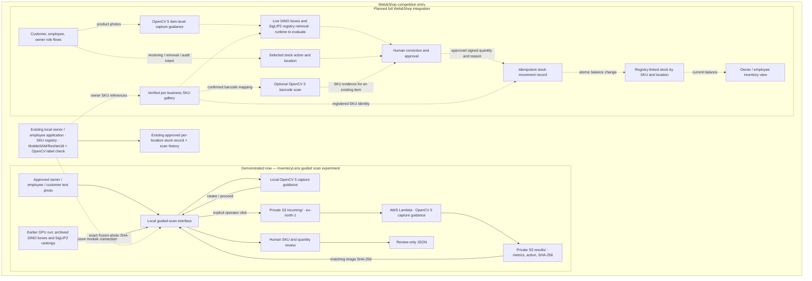

# Web&Shop — live inventory tracking with InventoryLens visual scanning

Submission draft for the OpenCV AI Competition 2026, prepared 2026-10-20. **Web&Shop is the application and competition entry. InventoryLens is its visual recognition, SKU registration, scanning, and inventory intelligence module.** The two names describe one product relationship, not separate entries. This repository contains the existing local InventoryLens application source, the isolated experiment code, the audited original photo dataset, and the AWS capture pilot's deployment and baseline files; the application database, the model weights, the per-image AWS outputs, and the image-bearing GPU artifacts (overlays, embeddings, run archives) are held locally and are not included here, while the completed 30-scene GPU run's verified text records are committed under [`results/imported_runpod_scene_results_20261020_v5_flat/`](../experiments/new_product_scanning_20261020/results/imported_runpod_scene_results_20261020_v5_flat/report.json); the complete role-based Web&Shop integration remains planned.

## Submission narrative

Web&Shop's central goal is to change and track inventory from scans of products in its registry. InventoryLens turns a product photo into proposed physical counts for registered SKUs; a completed, authorized receiving or removal scan records an **add or subtract movement** at the chosen location. The workflow must state the movement type because the photo cannot tell whether the same products were delivered, sold, or simply counted on a shelf. Product photos are difficult to count reliably when they are blurred, poorly lit, crowded, or partly hidden. A single detector box can contain two bottles, and a missed item can disappear from an automated count. OpenCV 5 analyzes the photo and requests a retake when an illustrative quality rule fails; a person then reviews product proposals, corrects SKUs and quantities, adds missed items, and resolves merged boxes before that stock action.

The intended primary workflow is **select stock action → scan photo → registered SKU and quantity → approve signed movement → updated balance**. DINO is the current experimental candidate to locate physical products, SigLIP2 to suggest registered SKUs, and OpenCV 5 to guide the full capture now and, after evaluation, inspect individual product crops for recapture needs. The existing local recognition path also uses OpenCV SIFT/RANSAC to verify printed label details when its reference matcher is uncertain. A barcode scan is an optional way to resolve the SKU of an item already seen in the picture; it must not count that item twice. In the planned role-specific integration, a completed authorized employee/owner movement would change the selected location's balance, while a customer picture count would support cart review and would not subtract stock until a sale is finalized. The existing local application instead **replaces counted SKU totals** after approval; it does not have the requested add/subtract movement ledger. The newer OpenCV/DINO/SigLIP2 experiment is not connected to either stock path.

The working competition demonstration connects an existing local InventoryLens guided-scan interface to a private S3-triggered Lambda in the Web&Shop AWS project, selected Region `eu-north-1`. The Lambda actually runs OpenCV 5 on the selected image and returns the capture metrics and `retake` or `proceed` decision. An operator must explicitly click to send a photo. The interface uses archived NVIDIA Retail DINO boxes and SigLIP2 candidate rankings only for exact-hash frozen photos. Those replayed outputs come from the earlier frozen GPU experiments, not from the separate 30-scene run described next; the demonstration does not run the models live on AWS. Human review produces review-only JSON and does not update production inventory.

Separately from that demonstration, the 30-scene DINO/SigLIP2 evaluation itself did complete. On 2026-10-20 it ran on a rented RunPod B300 GPU — outside AWS and outside the **$10 AWS spend ceiling**, because the AWS EC2 G/VT route stayed blocked at 0 applied vCPUs and was not used — producing [30 scenes and 93 detected boxes](../experiments/new_product_scanning_20261020/results/imported_runpod_scene_results_20261020_v5_flat/report.json) ranked against original, masked and combined galleries on identical detector proposals and query embeddings, with the previously validated detector remap (SHA-256 `c6185e3b1cd01abfe9d83e7f6f13083a8485b6cd0ca409642f237a5c65c36f41`) and a preflight gate on which every node ran on `TensorrtExecutionProvider` with no CPU fallback. Its `accuracy_metrics` is null **by design**: the ten SKU identities are unapproved and the scene labels unreviewed, so the output is provisional SigLIP2 ranks. No scene-level SKU accuracy, detection recall, precision or count-error figure is claimed from it, and no part of it ran on AWS.

Web&Shop's intended users are customers capturing products, employees scanning shelves or inventory areas, and business owners registering SKUs and overseeing stock. The existing local application supports owner registration and employee inventory workflows using its current MobileSAM/ResNet18 path plus conservative OpenCV label verification for some ambiguous matches. The OpenCV 5 guided-scan experiment is separate from that application path. Customer-specific interaction and a shared live DINO/SigLIP2 service are future integration work; customer test photos are already represented in the pilot evidence.

This entry uses OpenCV 5 for substantive pixel analysis: image decode, resolution checks, resize and grayscale conversion, Laplacian focus variance, and dark/bright pixel percentages. The result changes the next action shown to the operator. The AWS component performs that analysis on approved photos rather than merely storing them. The [competition requirements](https://opencv26.devpost.com/) call for substantive OpenCV 5 and a meaningful AWS component.

## Architecture and claim boundary

Solid arrows show implemented local or demonstrated/replayed paths. Dotted arrows show intended Web&Shop integration and are **not deployed**.

![Web&Shop architecture and claim boundary. Solid arrows: approved photo to the local guided-scan interface, local OpenCV 5 capture guidance with retake/proceed, an explicit operator click to private S3 incoming/ in eu-north-1, AWS Lambda OpenCV 5 capture guidance, private S3 results/ returned by image SHA-256, archived DINO/SigLIP2 replay on exact frozen-photo hashes, human SKU and quantity review to review-only JSON, and the existing local owner/employee application writing its approved per-location stock record. Dotted arrows: the planned Web&Shop integration that is NOT deployed - role flows, item-level capture guidance, live DINO/SigLIP2 registry retrieval, optional barcode evidence, human approval, idempotent signed stock movements, and registry-linked balances](architecture_20261020.png)

*Figure 1 - architecture and claim boundary. Rendered from [`architecture_20261020.mmd`](architecture_20261020.mmd); vector copy: [`architecture_20261020.svg`](architecture_20261020.svg). The Mermaid source below is the same diagram, kept for editing; the image is included because Devpost and PDF exports do not render Mermaid.*

The private bucket, Lambda, scoped role, and short-retention logs already exist in the Web&Shop AWS project. There is no public inference endpoint, live cloud DINO/SigLIP2 service, or automatic path from the experiment's review JSON to inventory. The [technical report](webshop_opencv_2026_technical_report_20261020.md) identifies every component and evidence source.

## Evidence presented to judges

| Evidence | What it supports | What it does not establish |
|---|---|---|
| Existing local registry, reviewed photo-count approval, per-location quantities, and scan history | A registry-linked **snapshot replacement** workflow exists in the local application | The requested add/subtract movement ledger, integration of the new AWS capture gate or live DINO/SigLIP2, or continuous updates between scans |
| 176 distinct approved originals processed in `eu-north-1`; all AWS hashes, capture actions, and metrics matched the local baseline | A deployed OpenCV 5 capture component that agreed with the committed local baseline on every one of the selected test originals, with CloudWatch duration and memory aggregates for the batch | Quality accuracy, generalization to new cameras and stores, or a re-run from this repository: the per-image AWS result JSONs are held locally, not shipped |
| Two in-memory blur/dark controls requested retakes; a separate live demo photo returned a matching `proceed` result | Image content changes the capture branch and the demo displays a real AWS result | Automatic SKU recognition on AWS |
| Five-image, 33-instance NVIDIA Retail DINO holdout: 27 TP, 0 FP, 6 FN at its tested settings | Promising provisional detector candidate | A matched-settings general benchmark, complete counting, or scene-level SKU accuracy on the newest 30 scenes, which remains unmeasured |
| Earlier SigLIP2 candidate rankings and 29-box frozen replay, attached only by exact image hash | Review interaction can expose suggestions and abstentions with provenance | Verified SKU accuracy or fresh inference in the demonstration |
| Newest isolated owner-reference review page (`latest_recognition_review_20261020.html`, held locally and available on request): 34 paired queries across ten provisional groups; box top-1 24/34, masked top-1 25/34 | One controlled oatmeal query was corrected when both owner query and gallery crops were masked | Employee/customer scene recognition, detector improvement, or live AWS model inference |
| Completed 30-scene DINO/SigLIP2 run, 2026-10-20, rented RunPod B300 GPU: [30 scenes and 93 detected boxes](../experiments/new_product_scanning_20261020/results/imported_runpod_scene_results_20261020_v5_flat/report.json) ranked against original, masked and combined galleries on identical detector proposals and query embeddings, previously validated detector remap `c6185e3b…c36f41`, preflight with every node on TensorRT and no CPU fallback | The prepared pipeline runs end to end on the newest unseen scenes and emits per-box provisional SigLIP2 ranks for all three galleries, with committed hashes and per-box records | **Scene-level SKU accuracy**, detection recall, precision or count error: `accuracy_metrics` is null by design because the ten SKU identities are unapproved and the scene labels unreviewed. It also establishes nothing about AWS — the AWS EC2 G/VT route stayed at 0 applied vCPUs and was not used |
| User-reviewed E01, B07, B10 corrections | The need for merged-box handling, missed-item additions, and one count across multiple views | Automatically correct counts |

The [pilot result](opencv5_aws_capture_pilot_result_20261020.md), [GPU audit](../data/recognition_checks/final_comparative_gpu_benchmark_20261018/complete_final_gpu_benchmark_audit_20261019.md), and the local replay human-correction notes (`review_corrections_20261020.md`, held locally and available on request) are the traceable source records. Owner_test, employee_test, customer_test, product-registration experiments, and benchmark artifacts remain in their existing locations.

## Judge demonstration and delivery

Use the [under-five-minute storyboard](webshop_opencv_2026_demo_storyboard_20261020.md) to show a real AWS `proceed` result, a retake control, archived product proposals, human correction, and the architecture boundary. The [guided-scan README](../experiments/opencv5_guided_scan/README.md) gives the local run command; the [AWS pilot README](../experiments/opencv5_guided_scan/aws_pilot/README.md) gives offline checks and packaging details. The submission still needs a recorded judge-accessible video, a judge-accessible code archive or repository, and a working endpoint or arranged live screen-share. These have not been published or arranged by this documentation update. [Official submission overview](https://opencv26.devpost.com/)

The [Devpost overview](https://opencv26.devpost.com/) currently displays **October 26 at 11:45 p.m. PDT** in its deadline banner but **11:59 p.m. Pacific Time** in its body. Plan to submit before the earlier displayed time and check the current official rules before publishing.
