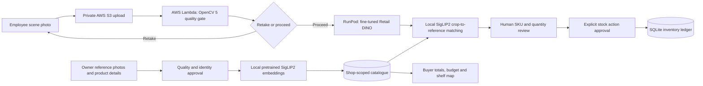

# WEB&SHOP technical report: training, evaluation and live application

Updated **26 October 2026**. This report supersedes the earlier 20 October report at this same URL. Historical experiment notes describe their state at the time; this report describes the integrated release and separates its evidence cohorts. WEB&SHOP is the application; InventoryLens is its visual registration and recognition module.

[Demonstration video](https://www.loom.com/share/8596593e2eed45c59e453312c88de972) | [Architecture](architecture.md) | [Evaluation summary](evaluation.md) | [Deployment](deployment.md)

## 1. Problem and users

Small shops need a shared product catalogue, reviewed stock movements and clear shelf information without training a new classifier for every product. A photograph alone cannot distinguish receiving goods from removing goods, and a detector can miss, merge or duplicate visible items. WEB&SHOP therefore makes the person responsible for identity, quantity and transaction approval.

Owners register products and references, employees review scene recognition and authorize inventory actions, and buyers use the same shop's prices and shelf locations. The demonstration uses fictional shop data. It demonstrates a working development application, not unattended production stock control.

## 2. Current system and substantive OpenCV/AWS contribution



The active application entrypoint is [`app_8509.py`](../app_8509.py). Its frontend, SQLite database, photographs and reference embeddings are local. GPU detection is reached through authenticated private SSH forwarding to the existing RunPod worker. SigLIP2 inference runs in the local application, not in Lambda or on that detector worker. This is a hybrid deployment; it is not fully hosted on AWS.

OpenCV 5 decodes images, records resolution, resizes quality-check inputs to at most 1024 pixels on the long side, and measures grayscale Laplacian variance plus dark/bright pixel proportions. The resulting retake/proceed decision controls whether the photograph advances to review. Local image geometry also supports box inspection. These operations provide actual capture guidance; OpenCV is not used merely to display model output.

The existing AWS pilot in **eu-north-1** uploads selected image bytes to a private S3 `incoming/` key. An S3 event invokes Python 3.13 Lambda, which writes quality metrics, decision, runtime versions and source SHA-256 to private result JSON. The application verifies the result belongs to its selected image. The recorded runtime was OpenCV 5.0.0; the pilot package pinned `opencv-python-headless` 5.0.0.93 and NumPy 2.5.4. An identical-image cached result is not a new Lambda invocation; an explicit local fallback must not be presented as AWS execution.

The pilot uses S3 public-access blocking, encryption, TLS-only access, a narrow service role, a one-day object lifecycle and three-day log retention. Lambda is configured for 512 MB and a 15-second timeout. These are the documented pilot settings, not a new resource audit or deployment performed for this report. Short retention makes preserved local evidence important. [Pilot implementation and measured audit](opencv5_aws_capture_pilot_result_20261020.md).

## 3. Three photo collections and their different roles

Here, a dataset means a collection of photographs, not a separate model. Training changes detector weights. Validation checks the fit during development. Evaluation compares fixed predictions with reviewed answers to measure failures.

| Collection | Contents and audit | Role |
|---|---|---|
| Dataset 1: early product scenes | K18/WOW/coconut and mixed early scenes; four reviewed photographs contributed 14 product boxes | Adds reviewed generic product examples to training; related K18 views stay in the same arrangement group |
| Dataset 2: grocery/shop scenes and references | The first two collections together resolve to 83 distinct scene hashes from 100 scene paths. The approved grocery subset has 26 photos/163 instances; 21 photos/130 boxes are training and five photos/33 boxes validation. Registration references are separate from detector scene annotations. | Supplies most detector training/validation examples and later the shop-specific reference gallery and live demonstration products |
| Dataset 3: later new-product collection | 42 owner reference photographs plus 25 employee and five customer scenes. All 30 scenes were human-boxed, totaling 291 visible items. | Held out from detector fitting; owner references form the retrieval gallery, while scene items support localization and retrieval evaluation |

The detector fit combines the four reviewed early scenes with 21 grocery scenes: **25 training images / 144 boxes**. Validation remains **five grocery images / 33 boxes**. The other 53 first-two scene images without approved item annotations were excluded from this fit. Not every photograph in datasets 1 and 2 was used for training.

Image SHA-256 checks found no byte-identical overlap between dataset 3 scenes and the first-two scene pool. This does not rule out similar physical arrangements in different files. Related arrangements must be grouped when splitting data. Dataset 3 was inspected during earlier model review, so it is held out from this training run but is **not a pristine blind test**. See the [split and annotation audit](../experiments/first_two_train_third_test_20261020/README.md) and [new-product dataset audit](../experiments/new_product_scanning_20261020/audit/dataset_audit.md).

We did not train on all three collections because then these same third-set scenes could no longer provide a held-out check. They could be used in a future training run, but that would require a new independent test collection. Registering owner reference photos with SigLIP2 is gallery construction, not detector training or neural-network retraining.

## 4. Model development and actual DINO fine-tuning

Earlier MobileSAM, reference-feature and YOLO experiments helped explore masks and annotation workflows. A local Retail YOLO11n CPU fine-tune was a separate baseline: 25 training images, five validation images, 640-pixel inputs, batch two and early stopping at epoch seven. It is not the detector deployed in the final video. Unapproved auto-generated annotation drafts were not used as ground truth.

The final detector was adapted from NVIDIA's **trainable Retail DINO v2.2.2.3**, using **TAO Toolkit 5.5** on an RTX 4090. An archived ONNX/TensorRT inference artifact could not substitute for trainable PyTorch weights; the completed fit used the trainable checkpoint and reviewed COCO boxes.

| Setting | Recorded configuration |
|---|---|
| Foreground identity | One generic `product` class; TAO configuration counts background separately (`num_classes: 2`) |
| Backbone | FAN base |
| Frozen modules | Backbone and transformer encoder |
| Training duration | 12 epochs; validation after each epoch |
| Batch / precision | Two images; FP16 with activation checkpointing |
| Optimizer | AdamW; learning rate 0.00001; weight decay 0.0001 |
| Learning-rate steps / seed | Epochs 8 and 10; seed 20261020 |
| Training / validation split | 25 images / 144 boxes; five images / 33 boxes |

The preserved training log records 12 validation evaluations and successful completion on **21 October 2026**. The final recorded validation mAP is **0.925367**, and mAP50 is **0.944852**. These are detector validation metrics from five images, not 92.5% SKU accuracy, a count-success rate, or a broad deployment guarantee. The report does not claim that this checkpoint was selected by an independent final-test optimization.

The deployed file is `model_epoch_011.pth` (390,300,806 bytes), SHA-256:

```text
8bb11d6d63f26edfd480bdf1264467bd5c080f190fbb83a034b252d13ee20d27
```

Local and connected-worker copies of the checkpoint, experiment specification and worker script matched by SHA-256 before shutdown. This verifies the later deployed assets; it does not cryptographically attest which bytes produced every historical experiment. The current live worker invokes the TAO PyTorch inference path, not the older custom TensorRT plugin path.

[Training configuration](../experiments/first_two_train_third_test_20261020/dino/train.yaml) and [extracted training-log and asset evidence](training_evidence_20261026.json) provide reproducible configuration/provenance without publishing weights, photos or private local paths. Original training logs and private image assets are retained locally.

## 5. Dataset 3 evaluation: localization and identity measured separately

### Detector localization

The reviewed reference contains one box per visible physical item across 30 scenes: **291 items**. Returned DINO predictions contain **278 proposals**. One-to-one matching sorts detections by confidence and matches to the highest-IoU unmatched ground-truth box at **IoU 0.50**.

| Metric | Result |
|---|---:|
| True positives / false positives / false negatives | 207 / 71 / 84 |
| Precision: fraction of proposals matching an item | 74.5% |
| Recall: fraction of annotated items detected | 71.1% |
| F1: balance between precision and recall | 72.8% |
| Employee-scene F1 / customer-scene F1 | 74.3% / 69.8% |

Misses, merged products, duplicate/partial boxes and crowded annotation decisions remain important failures. A proposal count is not a verified unit count. This test measures where products are, not their SKU identity.

**Historical provenance caveat:** the evaluator reads returned DINO KITTI labels, but its report copied timestamp/settings metadata from an earlier YOLO prediction JSON. The counts above come from DINO labels; the copied metadata must not be treated as reliable DINO run provenance. The preserved training and returned inference logs support completion separately. No new benchmark or corrected historical re-execution was performed for this consolidation. Evaluation source: `experiments/first_two_train_third_test_20261020/artifacts/third_set_review_20261020/dino_ground_truth_eval_20261023.json`, retained locally; evaluator: [`evaluate_dino_review.py`](../experiments/first_two_train_third_test_20261020/dino/evaluate_dino_review.py).

### SigLIP2 retrieval on manually boxed items

Pretrained SigLIP2 embeds reviewed item crops and compares them with the shop/reference gallery. Its weights were not fine-tuned on the new product identities. The final decision export has **291 rows: 290 confirmed candidate labels and one uncertain row**. On the 290 scored items, combined-gallery top-one agreement is **271/290 (93.4%)**; top-three agreement is **283/290 (97.6%)**.

These are **candidate-group agreement on manually cropped items**. The reviewer saw model suggestions; the registry did not formally confirm the ten retail identities at that evaluation. This is not blind sellable-SKU accuracy, unknown-rejection accuracy or automatic DINO-to-SKU accuracy. No confirmed unknown/not-listed examples were present. Do not multiply these percentages by detector recall to invent end-to-end accuracy.

The earlier 276-item partial decision export produced different results; the 290-item final export is used here. [Retrieval and review history](../experiments/new_product_scanning_20261020/README.md). Detailed final evaluation source: `experiments/new_product_scanning_20261020/results/reviewed_item_sku_ranking_20261023T075154Z/sku_decision_evaluation_20261024_v2/report.json`, retained locally.

### AWS capture evaluation

The frozen pilot batch covers **176 distinct original images** from 193 source paths. All 176 returned matching source hashes, capture decisions and metrics against local execution: **152 proceed, 24 retake, zero mismatches**. Two synthetic blur/dark controls requested retakes. This verifies cloud/local consistency and decision branching, not independently labeled photo-quality accuracy. The quality thresholds were developed with knowledge of local examples.

## 6. Return to dataset 2: final working owner-to-buyer demonstration

After adapting and evaluating the generic detector, the application used it with dataset 2 shop products and their registered reference gallery. This is a deployment demonstration on known shop products/new arrangements, not a claim that dataset 2 is an independent unseen-product test set. New reference registration does not require detector or SigLIP2 retraining.

The Loom recording, edited in CapCut, shows:

1. **Owner:** register Erbsen Eintopf from four reference views, enter identity, price, opening stock ten and shelf, review quality feedback, then save its unique SKU and actual SigLIP2 embeddings. A front reference supplies the catalogue photograph.
2. **Employee:** upload a different scene photograph, run the existing AWS capture check and actual DINO detection, then local SigLIP2 matching against the same shop's references. Boxes, candidate SKUs and unknowns are shown and corrected by a person.
3. **Inventory:** group repeated detections, correct quantities and assignments, select subtraction, inspect before/after stock and explicitly approve. The recorded new-product example changes ten units to eight. Opening quantity remains ten, a receipt records the action, and updated Excel export reflects current balances. Existing downloaded workbooks remain snapshots.
4. **Buyer:** use the same catalogue for price/shelf lookup, shopping quantities, totals, budget and a simple 2D shelf map. Camera-cart suggestions produce an unreviewed EUR 11.56 estimate in the recording; this is not a completed checkout and does not alter inventory.

Stock modes include Review only, Shelf Audit, ADD and SUBTRACT. Confirmed actions are shop-scoped, check balances/stale previews, and prevent duplicate posting. Mixed-shelf movements use each product's assigned shelf within an atomic action. Neural predictions never commit stock without approval. Catalogue/reference cache fingerprints make approved registrations available to subsequent matching.

A separate bounded development timing check measured **27.5903 seconds** for prepared recognition: DINO request 20.023 seconds and local matching 7.5673 seconds, with detector core 14.612 seconds. Upload, AWS quality check, cold preparation and rendering are additional. This is one scene under its recorded conditions, not the final video's guaranteed latency or a general throughput benchmark. [Timing evidence and limits](evaluation.md).

The final video link was confirmed playable in an incognito browser by the entrant. Photo authorship was also confirmed by the entrant. These are reported confirmations, not independent audio/content certification. The video uses fictional inventory data and must preserve honest disclosure of manual corrections and shortened processing waits.

## 7. Reproducibility, safety and current operating boundary

Use the pinned dependency files and [deployment instructions](deployment.md). Application safety checks use isolated temporary databases and explicit cloud/model mocks; model accuracy is supported by the separate evidence above. The published integrated release passed **69 targeted application checks** covering registration, inventory, workbook export, employee controls and judge/demo flows. Test success is not model accuracy.

The training split generator and COCO converter retain source hashes, approved annotation counts and arrangement membership. Private originals, model weights, reference embeddings, database, credentials and connection files are not distributed in Git. Reproducing GPU results requires the corresponding private assets, matching TAO runtime and explicit compute authorization; it is not a default CI operation.

There is one authoritative application database. Reference and scan evidence are local; temporary RunPod storage is not their durable source of truth. Use a consistent SQLite backup and include all referenced assets. On **25 October**, the existing Pod was explicitly stopped and verified `EXITED`; it was not terminated. LIVE GPU detection requires restoration/reconnection before the agreed demonstration, and GPU capacity on restart is not guaranteed. No training, inference benchmark, resource deployment or inventory action was performed to prepare this report.

The intended judge-access route is a private live screen-share. The entrant reports sending the organizer request; date/platform confirmation is pending. The local app address is not a public endpoint. The GPU need not run continuously while the recorded video and code are reviewed.

## 8. Limitations and responsible use

- Five validation photos cannot establish broad generalization. Dataset 3 was previously inspected, and some dataset 2 products/scenes contributed to training. A larger independent arrangement-level test is still needed.
- Dense shelves, occlusion, partial packaging, repeated units and visually similar variants can cause missed/merged boxes or wrong rankings. Full occlusion cannot be recovered from a single photograph.
- Unknown rejection and automatic end-to-end SKU/count accuracy remain unmeasured. Human corrections are part of the actual workflow, not hidden postprocessing.
- The map shows owner-authored shelf locations; it does not demonstrate indoor positioning or a verified shortest route. Buyer estimates are not sales transactions.
- The app remains a development release with local hosting/storage and externally scheduled GPU availability. It is not an unattended production service or a full AWS migration.
- Capture thresholds are illustrative. Cloud/local consistency does not establish capture-quality correctness across devices or lighting.
- Keep role credentials, keys, photo metadata and private evidence outside public recordings. Preserve shop boundaries and explicit inventory consent. Models, packages and photographs retain their applicable terms; see [third-party terms](third_party_licenses.md) and [security and licensing](security.md).

The contribution is an integrated, human-reviewed workflow: new catalogue registration without per-SKU retraining, substantive OpenCV capture guidance on AWS, adapted GPU product localization, local reference matching, auditable stock actions, synchronized Excel exports and buyer assistance. The evidence supports that workflow and its observed limitations, rather than a single overall accuracy percentage.
