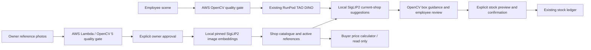

# WEB&SHOP 8509 registration release

Run `./tools/start_webshop_ux_demo.ps1` from the repository, then open http://localhost:8509. Owner: `owner` / `owner123`; employee: `employee` / `employee123`. The launcher uses the existing private RunPod tunnel configuration. It does not start a GPU. The original 8508 entry point and database are preserved.

## Working actions

Owner → **+ Add Product** → enter identity, price, opening quantity and an existing shelf → Continue to photographs → upload 3–5 views (or use the camera). Each photo has local OpenCV feedback, an explicit AWS analysis button and individual approval. Review the summary and explicitly Register Product. Fewer than three photos can be saved as an incomplete draft, excluded from retrieval. Existing products support Add Photos, price/shelf edits, current catalogue export and Test Recognition with a distinct photo.

Registration stores originals, normalized references, genuine checkpoint embeddings, quality evidence and stable SKU identity. Active references immediately change the content-bound employee gallery. Failed encoding does not leave a partly active product. Workbook imports retain registered images; provisional workbook IDs do not receive fabricated embeddings.

Employee opens directly into Retail DINO scanning. The photo and numbered boxes sit beside product groups with quantity controls, missed-item addition and expandable per-box correction/removal/splitting. Draft edits have stable IDs and provenance. Review-only is the default; ADD/SUBTRACT/AUDIT require a separate preview and explicit approval. Original photo, annotated analysis and JSON are saved under `data/webshop_ux_demo/fresh_scans/<shop>/<evidence>/`.

Buyer cards, list quantities, budgets and camera preview use the same shop prices. Unknown/unpriced products make totals incomplete. Buyer actions have no stock writer. The existing shelf map retains manual progress and only routes over a valid owner-authored grid.

## Actual cloud/model evidence

The supplied `Downloads/folder+` contains five reference photos IMG_5029–5033.jpeg and a distinct scene IMG_5034.jpeg. Actual owner-wizard registration created **P-3A72825C84A844CE, Freshona Lentils 400 g**, five references, without retraining. €1.49 and opening stock zero are explicitly fictional acceptance values.

Existing S3-triggered AWS Lambda `/aws/lambda/inventorylens-opencv5-capture-pilot-20261020` ran OpenCV **5.0.0** in eu-north-1. Its genuine hash-checked results are retained in `data/webshop_ux_demo/live_registration_acceptance.json`:

| Input | SHA-256 prefix | Sharpness | AWS decision | Lambda processing |
|---|---|---:|---|---:|
| Front reference | 6455dc2cc7d638fd | 334.23 | PROCEED | 1459.99 ms |
| Intentionally blurred reference | dada683041482846 | 1.18 | RETAKE | 1100.12 ms |
| Distinct shelf scene | 6d90718d1a3cdb5b | 1063.78 | PROCEED | 816.08 ms |

OpenCV measures blur, exposure and resolution before inference. Blur blocks registration/scanning; exposure-only overrides require a logged reason. Post-DINO OpenCV geometry flags overlap, near-frame boxes and low-detail crops, with retake/reposition/another-angle guidance. Overlap is not a measurement of visible product percentage. AWS failures remain UNAVAILABLE until retry or explicit LOCAL selection. Repeated identical hashes reuse genuine AWS results rather than claiming a new Lambda execution.

The already-running RunPod worker returned **10 actual proposals**. Its DINO subprocess took **14.722 s**; measured application recognition took **35.340 s**, including request/serialization and **13.348 s** matching. A separate browser run measured **69.58 s**; initial gallery/model loading on this memory-constrained laptop is slower than warmed execution. The front lentil-can box was assigned the newly registered SKU and visually checked against the saved image. A narrow partial-can proposal also received that SKU; its identity cannot be verified from the visible fragment. Partial proposals and unknowns still require review. Ten proposals are not ten verified product units. This single scene is not an accuracy benchmark.

Explicit employee approval posted receipt **6**, adding only one visually checked lentil can in the isolated database; all other proposals were excluded from that action scope with provenance. Buyer quantity two produced **€2.98**, with unchanged ledger. The acceptance script asserted original 8508 ledger and source hashes unchanged. It refuses to repeat a completed stock action.

## Recognition diagnosis

The old 8508 and pre-change 8509 default navigation opened the legacy MobileSAM scanner. The new employee landing opens the existing DINO pipeline. Fresh-photo DINO checkpoint remains `8bb11d6d63f26edfd480bdf1264467bd5c080f190fbb83a034b252d13ee20d27`; threshold 0.25. Orientation, floor/ceil crops, zero padding, SigLIP2 preprocessing, mean-top-two scoring, minimum similarity 0.55 and margin 0.05 remain unchanged.

The same actual scene boxes and eligible baseline gallery (14 SKUs / 50 references) produced identical old/new assignments. Before registration the lentil-can box was incorrectly assigned the existing beans SKU; after five real references it was assigned the new lentil SKU (15 SKUs / 55 references). This demonstrates missing identity coverage for this query, not a general recognition regression. No held-out threshold tuning was performed. Missed/merged detection rates remain unmeasured without box ground truth.

Confirmed fixes: route employees to DINO; bind gallery freshness to actual cached-mask and embedding content; persist registration embeddings; avoid retaining unnecessary full-size gallery buffers. A full local model load reproduced Windows paging-file exhaustion. The new loader loads the same pinned checkpoint's image tower only, checks all image weights loaded and uses the identical feature math. It follows the checkpoint's declared `siglip` architecture rather than incorrectly selecting the NaFlex `siglip2` architecture. No replacement weights or downloads were used.

## Architecture and reproduction



Targeted local regression command:

```powershell
.venv\Scripts\python.exe -m unittest tests.test_registration_8509 tests.test_live_scan tests.test_practical_ux tests.test_webshop_delivery tests.test_fresh_scan_ui
```

These tests use temporary databases, mocked model embeddings/AWS failures, and actual local OpenCV. The small architecture-equivalence test uses random tiny model weights to check identical feature math, not recognition accuracy. The separate `tools/verify_registration_8509.py --live` acceptance uses actual AWS, actual pinned SigLIP2 and actual DINO; only file selection is automated.

**44 targeted tests passed** (268.830 s), followed by **2 passing UI smoke tests** (26.480 s) after thumbnail-orientation and sidebar-contrast fixes. Logs: `data/webshop_ux_demo/targeted_registration_tests.log` and `final_thumbnail_smoke.log`. Actual browser screenshots: owner (local artifact: `webshop_8509_owner.png`), Add Product (local artifact: `webshop_8509_add_product.png`), employee review (local artifact: `webshop_8509_employee.png`), mobile registration (local artifact: `webshop_8509_owner_mobile.png`), mobile review (local artifact: `webshop_8509_employee_mobile.png`). Browser evidence is recorded separately in `data/webshop_ux_demo/browser_visual_evidence.json`; repeated captures of the same scene are not independent accuracy samples.

Changed implementation: `app_8509.py`, `visual_8509.py`, `owner_8509.py`, `registration_wizard_8509.py`, `registration_8509.py`, `owner_test_8509.py`, `quality_8509.py`, `siglip_8509.py`, `gallery_8509.py`, `scanner_8509.py`, `review_8509.py`, `buyer_8509.py`, the 8509 launcher and targeted evidence/test tools. Reuses existing services/importer/map/ledger instead of replacing them.

Competition material should show these actual measured stages, the architecture, limitations and reproducible setup, following the [official competition requirements](https://opencv26.devpost.com/). A narrated submission video and final external submission remain user actions. No Agentic Vision Award workflow is claimed. No new infrastructure, GPU starts, training or model downloads were performed.
