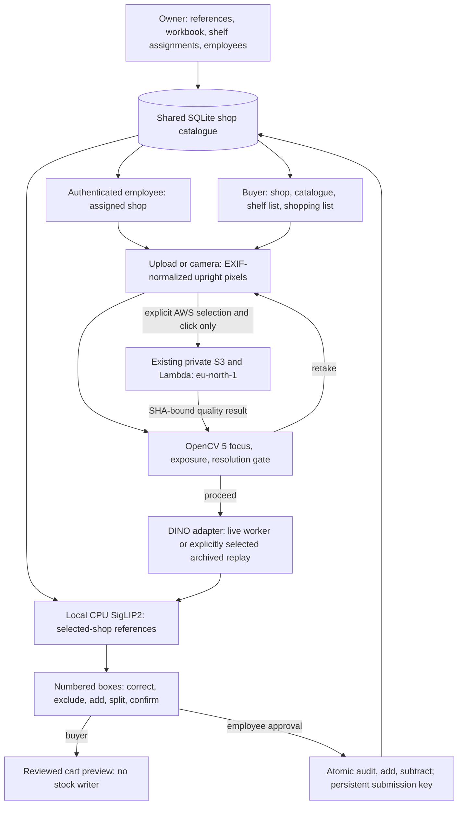

# WEB&SHOP release evidence — 24 October 2026

**LIVE update:** the existing RunPod DINO environment is now connected and verified through the employee UI. Six real proposals reached review in 87.81 s, with stock unchanged, using an existing historical photograph. See [restored connection and measured evidence](webshop_fresh_scan_setup.md). Earlier stopped-worker/blocker statements below describe the pre-restoration release state. A genuinely new-photo demonstration, video and judge access remain outstanding.

WEB&SHOP is one local Streamlit application; InventoryLens is its visual registration and inventory module. This document supersedes implementation-status claims in the 20 October submission documents and the earlier fresh-scan setup notes. **Submission is incomplete:** a genuinely new photo still needs a running DINO worker, and judge access/video publication remain outstanding.

## Implemented architecture



One existing authentication system binds each employee/owner to their approved shop. The shop name appears in the sidebar; this version supports one assigned shop per signed-in identity. Buyers select a catalogue-bearing shop publicly. Product `business_id` is shop_id; `sku` is the shop-local SKU identifier. Products hold price, unit, shelf_id, opening_stock, registration_status, optional confirmed brand/variant/size, and existing references. Owner, employee and buyer read those same rows. Shelf lists use owner-entered shelf IDs; there is no inferred floor plan or indoor positioning.

## Scan and inventory contract

Original bytes are retained in memory and hashed. Pillow applies EXIF once and emits a PNG with no orientation tag. The local quality gate, worker input, crops and overlay use the upright coordinate space. Responses must match normalized SHA-256, dimensions, xyxy convention and checkpoint SHA-256. Crop bounds round outwards. Empty detector output can still be reviewed with manually added rows or explicit zero-count audit scope.

LIVE requires the existing private TAO 5.5 worker and SSH tunnel. Checkpoint: `model_epoch_011.pth`, SHA-256 `8bb11d6d63f26edfd480bdf1264467bd5c080f190fbb83a034b252d13ee20d27`. SigLIP2 revision: `75de2d55ec2d0b4efc50b3e9ad70dba96a7b2fa2`, local CPU, local files only. No model weights were downloaded or training started for this release.

REPLAY is a separate photo-source choice. It uses only the exact historical photo whose normalized hash matches the preserved live response. Its DINO boxes are archived; SigLIP2 ranking runs anew against the selected shop. No unavailable worker silently becomes replay. Replay requires local private historical assets and is not bundled for redistribution.

Each box stays separately editable. Exclude a merged box and add its separate replacement rows; delete false rows, add missing items, change SKU/units/coordinates. Unknowns must be manually resolved or excluded. A grouped SKU summary combines repeated boxes. Explicit item confirmation and final action approval precede all writes. Capture mode, original/catalogue hashes, worker provenance, box review and timings can be exported.

SHELF AUDIT sets only explicitly reviewed SKU/location balances, including optional absent-SKU zero decisions. RECEIVING / ADD increases them. REMOVAL / SUBTRACT decreases them and rejects insufficient stock atomically. Transactions include operator, timestamp, source hash, submission key, operation, requested units and before/after balances. Repeated identical submissions return the original receipt; conflicting reuse is rejected. Correct a mistaken movement through a new reviewed compensating action linked in its notes, or a fresh audit; automated reversal is not provided. Legacy history has null before/after fields, because those values cannot be reconstructed reliably.

Buyer shopping lists and camera cart previews have no approval/write capability. Lists persist across search changes within the current session. No checkout or payments.

## OpenCV and AWS

Verified local `cv2.__version__`: **5.0.0**, wheel **opencv-python 5.0.0.93**. The existing Lambda uses OpenCV 5.0.0 with its headless 5.0.0.93 wheel. `capture_gate.py` rescales to a maximum 1024-pixel side, converts to grayscale, computes Laplacian variance and dark/bright pixel percentages, and checks resolution. The existing rule blocks recognition for unreadable/small, dark, overexposed or low-focus images. Its thresholds are provisional, not independently calibrated quality accuracy. The screen shows metrics, reason codes and RETAKE/PROCEED consequences.

The existing AWS component is private S3 incoming/results plus an S3-triggered Python Lambda in **eu-north-1**. An explicit click calls the existing client, which checks project/Region and binds the result to the original hash. A service error leaves recognition blocked until retry or an explicitly selected LOCAL check. No cloud resources, credential settings or pilot evidence were changed; no AWS/GPU calls were made by this implementation session.

Historical AWS evidence: 176 originals with local/cloud agreement, plus blur/dark retake controls. This measures execution consistency, not SKU or photo-quality accuracy. The preserved pilot report estimates its Lambda batch portion at **$0.00117 before credits**, excluding storage, requests, logs, taxes and other usage; this is a historical estimate, not a current bill. The approved ceiling remains $10. See [pilot evidence and cost calculation](opencv5_aws_capture_pilot_result_20261020.md). Current paid-plan/spend status was not queried because this release performs no AWS operations; check AWS Settings > Billing before authorizing more usage.

## Evaluation boundaries

| Evidence | Result | Meaning |
|---|---|---|
| Fine-tuned DINO validation | mAP 0.9254; 12 epochs; 25 train photos/144 boxes, 5 validation photos/33 boxes | Small development validation, not employee accuracy |
| Reviewed 30 scenes | Precision 74.5%, recall 71.1%, IoU 0.50 | Detector localization; crowded labels have uncertainty |
| 290 human-selected labelled crops | Top-1 93.4%, top-3 97.6% | Suggestion-visible SKU ranking agreement, not blind full-pipeline accuracy |
| Five employee photos | 37 human-counted units | Human labels only; no new automatic evaluation claimed |
| This release's real local replay smoke | 6 archived boxes, 1 unknown; 69.35 s; zero scan sessions before/after | Real current-shop SigLIP2 on historical DINO boxes, not new-photo detection or accuracy |

The employee labels do not provide paired, machine-readable automatic results in their review directory, so no new aggregate end-to-end accuracy is asserted. Sources: [delivery evidence audit](webshop_delivery_decision_20261024.md), [employee review](../experiments/new_product_scanning_20261020/results/employee_test_20261024/review.md). Unknown thresholds remain uncalibrated for this demo gallery. New arrangements of known second-set products do not establish unseen-product generalization.

## Reproduction and demo

Verified host: Windows, Python 3.14, existing `.venv`. Pin file: `requirements-webshop-release.txt` (includes the verified fresh-scan versions). For a new virtual environment install that file; the installation itself was not repeated. DINO needs the separate existing TAO 5.5 environment and compatible checkpoint. Reproduction of real recognition also needs lawfully obtained pinned SigLIP2 weights and owner-approved references; neither is embedded in source control.

```powershell
# In the project root, use the existing environment.
.\.venv\Scripts\python.exe tools\make_webshop_workbook.py
# Create once; refuses to overwrite. Reads existing local demo catalogue/references only.
.\.venv\Scripts\python.exe tools\prepare_webshop_release.py
.\tools\start_webshop_release.ps1
```

If the release folder already exists, skip preparation. Open **http://localhost:8508**. Local-only identities: `owner / owner123`, `employee / employee123`. The app binds to loopback. These credentials are unsuitable for public hosting.

1. Owner sign-in → Products → Import catalogue workbook / CSV → preview `data/submission_demo_catalog.xlsx` → approve/import. Leave opening-stock initialization unchecked when balances already exist. Inspect references and edit owner shelf assignments. Team creates approved employee access. Inventory shows balances and history.
2. Sign out → employee sign-in → Fresh-photo SKU scan → choose shelf. With no GPU choose Archived photo · REPLAY MODE → On this computer → Check this photo → Find products. Otherwise upload/take a new photo with the live worker connected. Correct numbered boxes, resolve unknowns, verify grouped units, select audit/add/subtract, then approve.
3. Switch Workspace to Buyer (or sign out and choose Buyer) → same shop → catalogue/prices/shelves → search/list → optional camera cart preview. Stock remains unchanged by buyer actions.
4. AWS guidance is opt-in: select AWS capture service, then Check this photo only when cloud usage is authorized. For an offline demo show the tested LOCAL retake/fallback behavior and describe historical AWS evidence honestly.

The release seed contains 14 registered catalogue candidates and 50 copied reference views, with fictional prices/opening balances/shelves where supplied. Unfilled values remain pending. Fripsy / MAKS-CRISPY remains explicitly pending package verification. `docs/demo/webshop_catalog.csv` is the shareable seed; `make_webshop_workbook.py` rebuilds Products and informational Shelves sheets. Products.shelf_id drives the imported shelf list. On a clean judge install, import this workbook and upload approved references through Owner; no private reference gallery is distributed.

Minimal LIVE unblock: authorize and start a compatible GPU worker, run the existing command below **on that worker**, then establish its authenticated direct SSH port forward and set the two local environment variables before launching Streamlit. Starting GPU compute is billable and was not performed.

```bash
export WEBSHOP_DINO_TOKEN='<random secret of at least 24 characters>'
python3 tao_dino_worker.py --spec /workspace/inventorylens-dino-eval/experiment.yaml --checkpoint /workspace/inventorylens-dino-eval/model_epoch_011.pth
ssh -N -L 8765:127.0.0.1:8765 <existing-direct-ssh-address>
```

```powershell
$env:WEBSHOP_DINO_URL = 'http://127.0.0.1:8765'
$env:WEBSHOP_DINO_TOKEN = '<same secret>'
.\tools\start_webshop_release.ps1
```

Keep the worker HTTP listener on loopback. Its implementation is `tools/tao_dino_worker.py`; see [worker setup](webshop_fresh_scan_setup.md). The SSH forward command runs on the local computer, not inside the worker. No GPU restart or credential/permission change is implied by these instructions.

## Executed acceptance checks

`tools/check_release_tests.py`: **63 tests PASS**, 0 failures/errors/skips, 118.515 s, isolated databases. This final run includes the approval/list/cart checks; their inference is explicitly simulated. The real replay smoke is separate from all mocked tests. Local Streamlit health on port 8508 returned HTTP 200.

| Scenario | Status | Evidence / limit |
|---|---|---|
| A Owner load/import | PASS | New fictional seed; actual rebuilt workbook imported; balances preserved |
| B Approved employee catalogue | PASS | Shared records and existing authenticated shop binding |
| C New photo → live DINO → review | BLOCKED | Worker/tunnel stopped; simulated transport/UI contracts pass; no fresh-photo inference claimed |
| D Rotated photo alignment | PASS | EXIF regression checks dimensions, crop pixels and overlay coordinates |
| E Repeated SKU quantity 3 | PASS | Three boxes sum to three, final approval UI check uses mocked inference |
| F Correct wrong SKU | PASS | Review validation accepts corrected registered SKU |
| G Missing/merged correction | PASS | Exclude merged proposal and add replacement rows |
| H Uncertain remains unresolved | PASS | Unknown/unconfirmed rows block approval |
| I Audit scope | PASS | Only reviewed SKU/location changes, including zero |
| J Add/subtract/duplicate | PASS | Balance checks, atomic rollback, operation-bound persistent idempotency |
| K Buyer shared catalogue | PASS | Identical SKU/price/shelf records; UI rehearsal |
| L Buyer list/cart no stock writes | PASS | Capability boundary, UI list and simulated reviewed cart |
| M Capture retake/fallback | PASS | Real local dark-image retake; simulated AWS outage requires explicit local selection. New live AWS call BLOCKED pending paid-operation authorization |
| N Cross-shop authorization | PASS | Foreign location and employee catalogue writes denied |
| O Three roles without DB restart | PASS | AppTest role switching; shared catalogue and shopping-list persistence |

Local full logs: `data/webshop_release_checks/tests.log`, `tests.json`, `data/webshop_approval_tests.log`; replay evidence: `data/webshop_release_demo/release_replay_smoke.json`. These local evidence files are excluded from a public archive unless reviewed. Re-run commands:

```powershell
.\.venv\Scripts\python.exe tools\check_release_tests.py
.\.venv\Scripts\python.exe tools\check_release_replay.py
```

## Five-minute video storyboard

| Time | Show |
|---|---|
| 0:00–0:45 | Owner catalogue import, actual registered references and fictional demo disclaimer |
| 0:45–2:00 | Employee photo, meaningful quality gate, numbered proposals; say LIVE or REPLAY aloud and on screen |
| 2:00–2:45 | Repeated SKU summary, unknown correction, merged/missing item correction |
| 2:45–3:25 | Distinct audit vs ADD/SUBTRACT; owner transaction history and duplicate protection |
| 3:25–4:05 | Authorized AWS retake/proceed, or label historical AWS evidence plus current LOCAL retake |
| 4:05–4:35 | Buyer same prices/shelves, shopping list/cart preview, no stock write |
| 4:35–4:55 | Architecture, separated evaluation metrics, GPU and identity limitations |

## Final submission / archive checklist

- [x] Integrated local source, pinned environment, reproducible workbook, diagram and technical report.
- [x] Targeted isolated tests, actual local replay/matching evidence and loopback launch.
- [ ] Run a genuinely new photo through the authorized live worker; preserve source hash, checkpoint, timings and review evidence.
- [ ] Owner verifies exact package identities/units and grants redistribution rights for any demo imagery. Keep Fripsy pending until resolved.
- [ ] Prepare a judge-accessible source repository/archive. Include app/service/UI source, tests, pin files, this report, safe CSV, `tools` helpers, and required pure modules under `experiments/hybrid_pipeline` and `experiments/opencv5_guided_scan`.
- [ ] Exclude `.env*`, `.aws`, `.streamlit/secrets.toml`, worker connection JSON, credentials/tokens, SSH keys, `.venv`, databases, logs, private/customer imagery, reference galleries, original archives and proprietary weights. Review filenames **and contents** before publishing; `.gitignore` alone is insufficient.
- [ ] Check model/image redistribution licences, NVIDIA notices, dependency licences and attribution; provide installation/source instructions for excluded weights.
- [ ] Record and publish a judge-accessible video under five minutes; rehearse the final actual workflow with honest runtime labels.
- [ ] Verify repository/archive and video links from a signed-out browser; arrange judge execution/access without exposing the private worker or credentials.
- [ ] Confirm current competition rules/eligibility and complete the submission form. User-supplied working cutoff: 26 October 2026, 23:45 PDT (27 October, 07:45 Europe/Zagreb after the daylight-saving change). This cutoff was not independently rechecked in this implementation session.

No final competition submission, public deployment or production migration has been performed.

## Complete Python paths edited in this implementation

- [app.py](../app.py)
- [auth.py](../auth.py)
- [db.py](../db.py)
- [images.py](../images.py)
- [inventory.py](../inventory.py)
- [owner_ui.py](../owner_ui.py)
- [live_scan.py](../live_scan.py)
- [scanner_ui.py](../scanner_ui.py)
- [buyer_ui.py](../buyer_ui.py)
- [shop_catalog.py](../shop_catalog.py)
- [tests/test_webshop_delivery.py](../tests/test_webshop_delivery.py)
- [tools/prepare_webshop_release.py](../tools/prepare_webshop_release.py)
- [tools/make_webshop_workbook.py](../tools/make_webshop_workbook.py)
- [tools/check_release_replay.py](../tools/check_release_replay.py)
- [tools/check_release_tests.py](../tools/check_release_tests.py)
